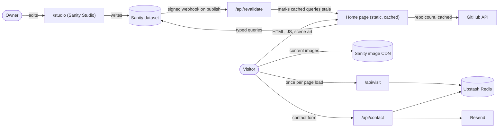

# Architecture

> The planned design as of 2026-11-16. Nothing in this file is built yet.
> Each part names the tasks that build it and the decision record behind it.
> A task that changes the design updates this file in the same commit.
>
> WHAT is in `docs/specs/0001-portfolio.md`, the task list in `docs/tasks/TASKS.md`,
> the reasons in `docs/decisions/`.

## The system in one picture



One Next.js app on Vercel serves everything: the single-page site, the embedded Studio and four route handlers. All content lives in Sanity. Redis holds only counters and rate-limit state.

## Stack and pins

Versions are the ones published on 2026-11-16. Decision 0005 explains the two holds.

| Area | Choice | Note |
|---|---|---|
| Framework | Next.js 16.4, App Router, React 19.3.x | React held below 19.4 because react-three-fiber 9.8 requires it |
| Language | TypeScript 6.0.x, strict | Held below 7 because `typescript-eslint` supports `<6.1.0` |
| Styling | Tailwind CSS 4 | Tokens defined in `globals.css` |
| 3D | three 0.187, `@react-three/fiber` 9.8, `@react-three/drei` 10.7 | Decision 0014 |
| Scroll | gsap 3.15 (ScrollTrigger), lenis 1.3 | Decision 0013 |
| CMS | sanity 6, next-sanity 13, `@sanity/image-url` | Decisions 0008 to 0011 |
| Data | `@upstash/redis`, `@upstash/ratelimit`, resend, zod 4 | Decisions 0018, 0019 |
| Tooling | pnpm, ESLint 10 (flat config), Prettier, Vitest (proposed) | Decisions 0005, 0007 |
| Hosting | Vercel Hobby, deployed from GitHub on push | Free tier only |

## Repository layout (planned)

```
src/
  env.ts                     typed environment variables, fails fast
  app/
    layout.tsx               root: html, body, fonts
    globals.css              design tokens
    fonts/                   self-hosted font files
    (site)/
      layout.tsx             nav, smooth scroll, scene, footer, analytics
      page.tsx               the home page: all chapters, server-rendered
    studio/[[...tool]]/      embedded Sanity Studio, own layout, noindex
    api/revalidate/          Sanity webhook
    api/visit/               visit counter
    api/contact/             contact form
    resume/route.ts          redirect to the current resume PDF
    not-found.tsx, sitemap.ts, robots.ts, opengraph-image.tsx
  sanity/
    client.ts, fetch.ts      client and the cached, tagged fetch helper
    queries.ts               every GROQ query, typed
    image.ts                 image URL builder and loader
    structure.ts             Studio sidebar
    schemaTypes/             objects and documents
  components/
    chrome/                  Nav, MobileMenu, Footer, Loader, chapter parts
    sections/                one folder or file per chapter
    ui/                      SanityImage, Lightbox, RichText
    motion/                  SmoothScroll, ChapterTriggers, Reveal
    scene/                   canvas, camera, stations, cutouts, quality
  lib/                       pure logic: chapters, visits, contact, commit graph
scripts/                     content import, scene art, env and content checks
public/scene/                optimized scene art
studies/                     Phase A design studies (not part of the app)
docs/                        spec, tasks, decisions, design, audits, runbooks
sanity.config.ts, sanity.cli.ts, sanity.types.ts (generated)
```

CLAUDE.md rules that shape this: Server Components by default; one component per file; all queries in `src/sanity/queries.ts`; all environment access through `src/env.ts`.

## Rendering and data flow

Decision 0010. Built in T-027, T-028, T-032.

1. The home page is a Server Component. It runs one typed query per section through `sanityFetch`, which caches each result under a tag named after the document type.
2. The page is rendered once and served as static HTML.
3. When the owner publishes in Studio, Sanity calls `/api/revalidate` with a signed payload. The handler checks the signature and marks the matching tag stale.
4. The next request re-renders the page with fresh data. The target is under 60 seconds from publish to live, with no redeploy.
5. A one-hour timed refresh is the safety net if a webhook is ever missed.

`/resume` redirects to the current PDF in Sanity, so the nav button and any saved link always reach the latest upload.

## Content model

Decision 0009. Built in T-021 to T-026. Every image field is an image with a crop hotspot and required alt text.

| Type | Kind | Holds |
|---|---|---|
| `siteSettings` | single | name, title line, location, public email, social links, resume PDF, SEO |
| `homePage` | single | per-chapter label, heading, intro and optional caption; hero copy; About text and quick facts; contact copy; footer line; loader line; 404 caption |
| `skillGroup` | collection | group title, skills, order |
| `experience` | collection | role, company, type, dates, highlights, stack, commit title |
| `project` | collection | title, slug, summary, tech, links, featured, order, cover, gallery (up to 6) |
| `post` | collection | title, link, date, reading time, tags, optional cover (decision 0001) |
| `certification` | collection | name, issuer, date, status, credential link, badge, certificate |
| `milestone` | collection | stage, focus, status, order |

Chapter order and ids live in code (`src/lib/chapters.ts`); chapter copy lives in Sanity. Button labels and aria text are fixed in code, as CLAUDE.md allows.

Content first arrives through the import script (T-030, T-031), which reads `content.md`, leaves `[FILL]` fields empty and holds back list items marked `[CHECK]`.

## The page

| # | Label | Section | Content from | List layout (Phase D) | Motion on top (Phase E) |
|---|---|---|---|---|---|
| – | `provisioning` | Loader | `homePage` | none | real-progress overlay |
| 00 | `git init` | Hero | `homePage` | heading, intro, two buttons | reveal once |
| 01 | `dependencies` | Skills | `skillGroup` | proposed in T-037 | reveal once |
| 02 | `README.md` | About | `homePage` | rich text and quick facts | reveal once |
| 03 | `git log` | Experience | `experience` | ordered list | pinned commit graph |
| 04 | `deployments` | Projects | `project` | grid, detail dialog | pinned horizontal track with pipeline bar |
| 05 | `docs/` | Writing | `post` | list of cards | sticky stacked cards |
| 06 | `checks passed` | Certifications | `certification` | checks panel, expandable rows | run sequence on first entry |
| 07 | `TODO:` | Where I'm heading | `milestone` | proposed in T-046 | reveal once |
| 08 | `open a pull request` | Contact | `homePage` | form | reveal once |
| – | `exit 0` | Footer | `homePage`, stats | links and three stats | none |

Which station each chapter shows is set by the beat ledger in T-003. The four patterns in the last column are reserved by CLAUDE.md; no other section reuses them.

### Three layers

Decision 0012. This is what keeps all content readable when motion or 3D is off.

1. **Content layer.** Server-rendered HTML in list layouts. Complete on its own.
2. **Motion layer.** Client components that add smooth scrolling and the four scroll patterns over the same markup. Mounted only when the visitor allows motion.
3. **Scene layer.** The lazy-loaded WebGL canvas fixed behind the HTML. Mounted only when motion is allowed, WebGL works and the device keeps up.

| Visitor | Content | Scroll patterns | Background |
|---|---|---|---|
| Desktop | full | all four | live scene |
| Phone | full | all four | live scene at the mobile setting |
| Device that cannot hold 30 fps | full | all four | static scene image |
| Reduced motion | full | list layouts | static scene image |
| No JavaScript | full | list layouts | static scene image |

## Scroll and scene

Decisions 0013 to 0017. Built in T-049 to T-075, ported from the master study (T-012, T-013).

- **One conductor.** ScrollTrigger watches each chapter and writes the current chapter and its local progress into a small store (`src/lib/scrollStore.ts`). Nothing else listens to scroll.
- **Camera.** `cameraPath.ts` holds one shot per chapter along a single rising spline. `CameraRig` reads the store every frame and eases the camera toward the pose for the current progress. During the long pinned sections the camera holds its shot.
- **Stations.** Six groups of procedural geometry (no model files), each built by a plain three.js factory and mounted through react-three-fiber.
- **Foreground cutouts.** Ordinary images from `public/scene/`, pinned over the canvas per chapter with slight parallax (decision 0002).
- **Effects.** Ambient particles in the scene, a cursor trail for mouse users, a touch ripple for touch users.
- **Lifecycle.** The three.js chunk loads after first paint. Rendering stops when the tab is hidden. Everything is disposed when the canvas unmounts.

Quality settings. The mobile row comes from the spec; the rest is fixed in T-060.

| Setting | Pixel ratio cap | Particles | Post-processing | Canvas |
|---|---|---|---|---|
| High (desktop start) | 2 | 100 % | as decision 0004 requires | yes |
| Mobile start | 1.5 | 40 % | lighter | yes |
| Low | set in T-060 | set in T-060 | off | yes |
| Static | – | – | – | no, static scene image |

A performance monitor steps down one setting at a time and switches to Static only after the frame rate stays under 30 fps.

Loading: the hero text is in the server HTML, so it can paint before any script runs. The loader is an overlay fed by real load events, capped at 3 seconds, with a CSS failsafe so it clears even if JavaScript fails. Whether the static still is in the server HTML for every visitor or only for the static cases is settled in T-050 against the LCP measurement.

## Integrations

- **Visits** (decision 0018, T-076 to T-078). A small client beacon calls `/api/visit` once per page load. The handler skips bots, hashes the visitor (IP, user agent, date and a secret salt), adds the hash to that day's set in Redis and raises the total only if the hash is new. Day sets expire after 48 hours. Counting runs on the production deployment only.
- **Footer stats.** Visits from Redis, public repository count from the GitHub API (cached, with the last known value as fallback), post count from Sanity. Each slot shows a dash on failure.
- **Contact** (decision 0019, T-047, T-080, T-081). The form posts to `/api/contact`, which validates with the same zod schema the form uses, drops honeypot hits silently, applies a rate limit in Redis and sends through Resend with reply-to set to the sender. On any failure the form shows a mailto link.
- **Analytics** (T-079). Vercel Web Analytics on the site layout only, not on `/studio`.

No Hashnode integration exists (decision 0001).

## Environment variables (planned)

Names are provisional until T-016 reconciles them with the existing `.env.example`, which could not be read during planning. Each variable is added to `src/env.ts`, `.env.example` and Vercel in the task that first needs it.

| Variable | Used for | Added in |
|---|---|---|
| `NEXT_PUBLIC_SITE_URL` | canonical URLs, sitemap, share image | T-016 |
| `NEXT_PUBLIC_SANITY_PROJECT_ID`, `NEXT_PUBLIC_SANITY_DATASET` | Sanity client and Studio | T-020 |
| `SANITY_WRITE_TOKEN` | import script only; local machine only, never Vercel | T-031 |
| `SANITY_REVALIDATE_SECRET` | webhook signature | T-032 |
| `UPSTASH_REDIS_REST_URL`, `UPSTASH_REDIS_REST_TOKEN` | visits and rate limits | T-076 |
| `VISIT_HASH_SALT` | visitor hashing | T-076 |
| `GITHUB_TOKEN` (optional) | higher GitHub API limit | T-078 |
| `RESEND_API_KEY`, `CONTACT_TO_EMAIL`, `CONTACT_FROM_EMAIL` | contact form | T-080 |
| `GOOGLE_SITE_VERIFICATION` (optional) | Search Console | T-093 |

## Security and privacy

- The visitor counter sets no cookie and stores no IP address, only a salted daily hash that expires.
- The webhook is rejected without a valid signature. The write token never leaves the owner's machine.
- The contact endpoint validates on the server, uses a honeypot and is rate limited.
- The Sanity dataset is public on the Free plan: published content is readable by anyone, so nothing private is published.
- `/studio` and `/api` are excluded from robots and the sitemap.
- The phone number is never rendered; T-088 checks the built HTML. The resume PDF is public and carries it by the owner's choice.

## Out of scope for v1

From the spec: authentication, comments, likes, newsletter, a blog hosted on this site, a light theme, internationalisation, and 3D anywhere except the landing scene. Added by decision 0003: a separate page per project.

## Risks

1. **Lighthouse mobile 85 and LCP under 2.5 s with a WebGL scene and a loader.** The spec lets the loader hold content for up to 3 s while LCP must be under 2.5 s, and these pull against each other. A Lighthouse baseline is recorded at T-050 and rechecked at T-065 and T-087, so a problem shows early.
2. **All four pinned patterns on phones.** Pinning under native touch scroll, address-bar resize, and a sideways track driven by vertical swipes are the hardest parts on iOS Safari. Each has a phone check. If one cannot be made solid, a spec change is proposed; nothing is quietly degraded.
3. **Phone testing depends on the owner.** CLAUDE.md requires a real phone for every 3D task, about 25 of them.
4. **Library versions are newer than the planning notes in places.** Each task starts from current docs, and the scaffold comes from the official generator.
5. **Version holds.** TypeScript stays on 6.0.x and React on 19.3.x until the lint tooling and react-three-fiber catch up.
6. **Free-tier ceilings.** Sanity Free has hard caps. Resend allows 100 emails a day, which the rate limit protects. Vercel Hobby is for non-commercial use.
7. **Content blockers.** There are 15 `[FILL]` and 2 `[CHECK]` items, and covers and the resume must be uploaded. T-090 blocks launch on them.
8. **Generated scene art.** Consistency across about a dozen images, clean transparent edges, file size, the generator's licence terms, and trademarks: no Azure, AWS, Kubernetes, GitHub or NVIDIA marks in the art or the scene.
9. **Originality.** The method is shared with Kage on purpose, and the audit rubric flags a distinctive choreography repeated across chapters even when assets differ. The world, palette, type, section structure and motion are original; no code, class names, copy or artwork is reused; T-091 can block launch.
10. **The webhook is the single path for fast updates.** The one-hour refresh is the safety net, and the runbook covers checking the webhook log.
11. **Real env files are unreadable to the assistant, by design.** A wrong value shows up through the fail-fast message or through the owner.
12. **Embedded Studio** must stay out of the site layout, smooth scroll, analytics and sitemap, and adds peer-dependency constraints.
13. **Keyboard and screen-reader access to pinned patterns.** The list markup stays the source of truth (decision 0012).
14. **Size.** 95 tasks, each with an approval. Phases B to D do not need the art, so they can proceed while it is generated; from T-062 the art is on the critical path.
15. **The reference site may change or disappear.** T-002 captures it first.
